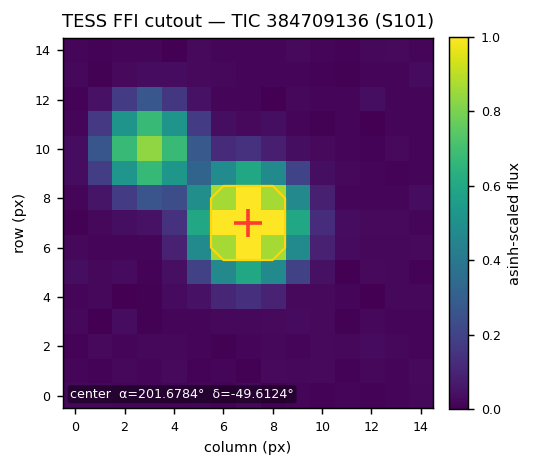
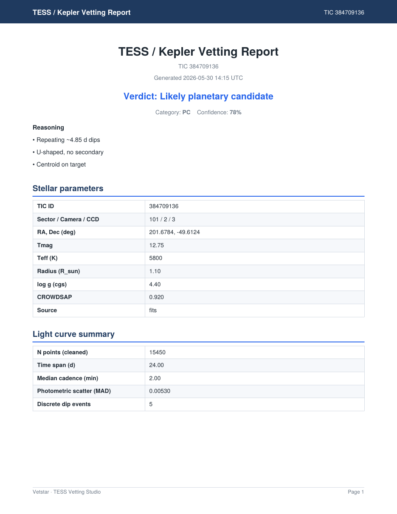
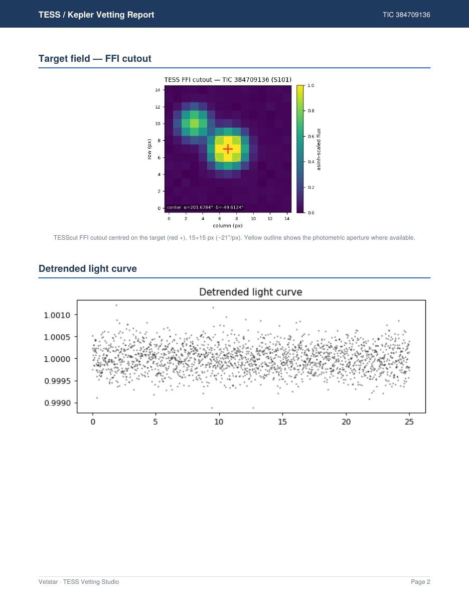

# Vetstar v2: NEMESIS and OGLE GUI

**A beginner-friendly GUI for peer-reviewed planet-search pipelines.**
Search a TESS star with the same methods professional surveys use, without
installing anything or writing code.

Professional pipelines are hard to start with: pinned Python
environments, long notebooks, dozens of settings, and outputs written for
experts. Vetstar v2 puts two of them behind a guided web interface and
explains every result in plain words.

## Peer-reviewed pipelines, made accessible

| In Vetstar | Pipeline | Published method | What Vetstar adds |
|---|---|---|---|
| **Transit → NEMESIS (guided)** | [NEMESIS](https://github.com/daxfeliz/NEMESIS): TESS full-frame-image photometry, PLD detrending, BLS + TLS search | Feliz et al. 2021, *AJ* 161, 247 ([doi](https://doi.org/10.3847/1538-3881/abedb3)); NEMESIS II survey: Feliz et al. 2026, [arXiv:2611.21758](https://arxiv.org/abs/2611.21758) (submitted to *AJ*) | A four-step wizard, a live progress bar, NEMESIS II paper-style figures with "how to read this plot" notes, and the full NEMESIS PDF report |
| **Transit → vetting tests** | [LEO-Vetter](https://github.com/mkunimoto/LEO-vetter), run by NEMESIS on every detection | Kunimoto et al. 2025, *AJ* 170, 280 ([arXiv:2509.10619](https://arxiv.org/abs/2509.10619)) | Each of the 18 tests shown as pass / flag with a one-line explanation, and a plain verdict: planet candidate, likely false positive, or needs a closer look |
| **Microlensing → OGLE search** | OGLE-IV event selection, adapted to TESS | Mróz et al. 2019, *ApJS* 244, 29 ([doi](https://doi.org/10.3847/1538-4365/ab426b)), building on Mróz et al. 2017 (*Nature* 548, 183) and the OGLE Early Warning System (Udalski 2003, *AcA* 53, 291) | Runs the cuts on a whole light curve with no window to mark, shows every cut with its OGLE value and TESS adaptation, then hands the event to the PSPL / flare / null classifier |

Vetstar runs these methods; it does not replace them. Please cite the
original papers when you use results (see [References](#references)).
A detection is a **candidate**, not a confirmed planet or event.

The first real run reproduces the NEMESIS II paper's TOI-1235.01 result
(TIC 103633434, Sector 20): TLS period 3.448 d, depth 0.77 ppt, radius
1.905 R⊕, SDE 15.3, LEO-Vetter planet candidate.

## What's in v2

- **Transit**: *NEMESIS (guided)* is the default mode. Pick a star and a
  sector, keep or change the defaults, watch the run, then read the verdict,
  the LEO-Vetter tests and four explained plots. The v1 pipeline stays as
  *Quick check* (upload a SPOC FITS file or pull one from MAST), and the
  v1 FFI cutout, ExoFOP-TESS parameters and HCI v2 habitability score still
  work on NEMESIS results.
- **Microlensing**: *Step 1* is the automatic OGLE-IV search; *Step 2* is
  the existing PSPL / flare / null model comparison on the event it found.
  TESS sector coverage of known events is unchanged.
- **Design**: a new look with dark mode, set out in [DESIGN.md](DESIGN.md)
  (Google Fonts, an OKLCH palette built from two brand sets, WCAG AA contrast).

No install required.

**Live at <https://vetstar.onrender.com>** (v1). The v2 test site is
<https://vetstar-v2.onrender.com>.

The first visit after the service has been idle may take ~30 seconds to
wake up (free-tier cold start); after that it runs normally. A NEMESIS
search then takes a few minutes on the NEMESIS worker.

Source code and issue tracker: <https://github.com/eagnespuerto/vetstar>

> **In-depth scientific documentation:** see
> [docs/SCIENCE.md](docs/SCIENCE.md) for a full mathematical / algorithmic
> walkthrough of the pipeline: detection, periodograms, transit geometry
> (TLCM), POE forward model, RV mass function, HCI scoring, ExoMiner views,
> and FFI rendering, with every governing equation rendered as a LaTeX
> image.

## What it does

The app is divided into two top-level pipelines, chosen via the **Transit /
Microlensing** tabs in the header.

- **Transit** opens on *NEMESIS (guided)*, described
  [above](#peer-reviewed-pipelines-made-accessible). The two *Quick check*
  tabs run Vetstar's own pipeline, described next. It is faster, works on
  an uploaded light curve, and is the one the Raspberry Pi port uses.
- **Microlensing** opens with the automatic OGLE-IV search (Step 1), then the
  model-comparison classifier and the TESS coverage finder described below.

### Transit Quick check (Vetstar's own pipeline)

- **Period searches**: Box Least Squares (BLS) + Lomb-Scargle periodograms
- **Adaptive dip event detection** with adjustable sensitivity (see below)
- **Optional sinusoidal-regression detrend** before BLS (toggle: *High stellar
  variability*). Fits a sine + first harmonic at the Lomb-Scargle peak (or a
  user-supplied rotation period) and subtracts it from the flux, so BLS sees
  only the residual. Helps surface shallow planetary dips on spotted rotators
  and other wave-like variables; skipped automatically if the fitted amplitude
  falls below the per-cadence noise floor.
- **Centroid offset test**: distinguishes on-target events from background blends
- **Odd / even transit depth comparison**: eclipsing-binary indicator
- **Secondary eclipse search** at phase 0.5, with a user-tunable σ threshold
  (1.0σ–7.0σ, default 3σ)
- **Transit shape analysis** (U vs V, ingress / egress / flat-bottom durations)
- **Physics-based companion sizing** with CROWDSAP dilution correction
- **Target field (FFI cutout)**: a Full-Frame-Image thumbnail of the patch
  of sky the light curve came from, fetched from MAST's **TESScut** service
  and rendered with an asinh / percentile stretch (the same scaling
  `astrocut` uses). The target is marked with a red **+** and the photometric
  aperture is outlined in yellow. It is a quick eyeball check for a bright
  neighbour or background eclipsing binary blended into the aperture (see
  [Example output](#example-output)). Auto-loads in its own panel below the
  results and is embedded in the PDF.
- **Automated verdict**: planet candidate / EB candidate / blend / ambiguous
- **BTJD → BJD epoch helper**: a guide just below the verdict reminds you that
  TESS times are in BTJD and ExoFOP expects BJD (BJD = BTJD + 2,457,000), and
  shows the candidate's own epoch converted.
- **ExoFOP-TESS TOI parameters**: a standalone observables section (separate
  from HCI) lays out the full ExoFOP
  TOI submission parameter set: the four required fields (period, epoch in
  BJD, depth in ppm, duration in hours) plus inclination, impact parameter,
  Rp/R★, a/R★, radius, mass, equilibrium temperature, insolation, stellar
  density, semi-major axis, eccentricity, and RV semi-amplitude, mapped from
  the measured and derived quantities and ready to copy into ExoFOP. The same
  table is included in the PDF.
- **Multi-event diagnostic plots**: full light curve with all events shaded
  and numbered (with the y-axis sized to keep every detected event's trough
  visible. Earlier versions used a fixed 0.3 percentile floor that clipped
  the deepest dips on EB-like targets), multi-panel zoom grid showing depth
  + duration + SNR per event, centroid behaviour, BLS and Lomb-Scargle
  periodograms. When the
  sinusoidal-detrend toggle is on and the fit was applied, a **Stellar
  variability detrend** panel is added (raw flux + fitted sin/harmonic
  overlay + residual fed to BLS) and is shareable to ImgBB like the other
  plots
- **LC plot view controls** (presentation only; detection logic is
  unaffected). The full-LC plot defaults to a **1-day rolling-median flatten
  + 30-min binned overlay**, so shallow dips don't drown in long-period
  variability on noisy targets. Toggles above the plot let you turn the
  detrend on/off and pick the bin width (off / 10 min / 30 min); switching
  re-renders the plot via the same progress-tracked path as a fresh run, so
  the bar climbs while it works. The same toggles are available on the
  in-browser **Manual tiny-dip selector**, applied client-side so dragging
  stays snappy. Analysis still always runs on the raw cadences.
- **One click: vet + PDF.** **Vet & build PDF report** (Upload tab) and
  **Fetch, vet & build PDF report** (MAST tab) run a single job: the
  vetting appears on the page as soon as it finishes, then the PDF is built
  from that same result and a **Download PDF report** button appears. No
  second MAST download or pipeline run.
- **Slow fetches start first.** As soon as the target's TIC/sector/
  coordinates are known, the job starts the slow remote fetches in a small
  background pool, heaviest first: the TESScut FFI cutout, the SPOC DVT
  file, the Gaia/SIMBAD/NEA cross-match, then ExoFOP. They overlap the
  light-curve download and BLS, so the pipeline doesn't stall on them later.
- **Sized for 512 MB.** One vetting job runs at a time (`VETSTAR_MAX_JOBS`,
  default 1; later jobs show "Waiting for a free worker"), the prefetch pool
  has 3 threads, the light-curve cache keeps the last 6 targets, and only the
  last 4 PDFs are kept, each for 30 min.
- **Phase-aware progress bar.** Stage-by-stage progress streams over
  Server-Sent Events and is grouped into four phases: Load light curve →
  Vet → SPOC DV + habitability → PDF report. The bar turns green for the PDF
  phase and stays up under the results until the PDF is ready.
- **PDF report** for archiving: a clean, consistent multi-page layout: every
  page carries the same header band and a footer with page numbers, tables
  share one zebra-striped style, section headings stay attached to their
  content (no orphaned headings across page breaks), and embedded plots keep
  their true aspect ratio. The report is self-contained: alongside the vetting
  tables and diagnostic plots it embeds the **FFI cutout**, the **Habitability
  Chance Index** (with the combined HCI summary image; see below), the
  **predicted observables (POE)**, the **TLCM** transit-geometry values, the
  **ExoFOP TOI parameters** table, and the full **ExoMiner** feature set
  (scalars + diagnostic views). These extra analyses are recomputed
  server-side at report time, so a single click yields a report covering every
  analysis the studio offers (each block is skipped gracefully if the
  underlying data, e.g. a TIC ID for ExoFOP, is unavailable).
- **Multi-sector PDF report**: the multi-sector panel can export the
  representative sector's single-sector report (the sector with the highest
  BLS SDE).

### Microlensing pipeline: OGLE GUI

**OGLE-IV event search.** Load a TESS light curve (by TIC and sector, a
file, or a demo) and click **Run OGLE search**. Vetstar scans the whole
light curve with the event selection of Mróz et al. (2019): at least 3
points in a row ≥ 3σ above the baseline with χ²₃₊ ≥ 32, a flat light curve
outside the event, a single bump of at least 0.1 mag, then a PSPL fit and
the paper's final cuts on χ²/dof, u₀, t_E and blending. Each cut shows its
value, the rule, and how it was adapted to TESS: the event window is sized
from the fitted model (OGLE uses 720 days, longer than a sector), flatness
is tested against the PSPL baseline, and the difference-imaging cut is not
applicable.

**Cleaning first.** Many TESS stars vary slowly (spots, pulsations), which
hides short bumps from a flat-baseline search. When the smoothed light
curve dips well below its level on both sides, Vetstar divides out a
half-day running median, with bumps masked so they survive. A single
microlensing event rises and falls once, so a quiet star with an event is
left alone. The OGLE selection itself is unchanged.

**Figure.** One matplotlib plot shows the light curve OGLE analysed, the
strong bumps (▼), the event window, the PSPL fit and the residuals.

**ExoFOP-TESS files.** Two bulk-upload zips: the OGLE figure (with the
TESScut cutout when available), and the raw light-curve FITS. See
[Bulk ZIP for ExoFOP-TESS upload](#bulk-zip-for-exofop-tess-upload).

**TESS coverage (Module B).** Upload a CSV of known or candidate events
(`event_id, ra, dec, t0, tE`, as Gaia Alerts, OGLE, MOA and KMTNet publish
them). For each event, Vetstar finds the TESS sectors, cameras and CCDs
that cover it and checks whether `t0` falls inside each sector. Each
observable row has an **Analyze →** button that loads its TESS light curve
into the OGLE search.

One limit: the Galactic bulge, where microlensing peaks, sits at ecliptic
latitude ≈ −5.5°, in TESS's thinnest coverage. Most classic bulge events
come back **not observable**. Events at mid or high ecliptic latitudes are
the realistic targets.

**Temporarily paused:** the TESScut FFI + Gaia DR3 overlay, while the Gaia
ESA Archive is down for Gaia DR4 (25 November to 2 December 2026, per
[ESA](https://www.cosmos.esa.int/web/gaia/news)). It returns after DR4.

### Habitability Chance Index (HCI)

A 0–100 score grounded in the **STEHM** (Smaller Than Earth Habitability
Model) framework from Hill et al. (2026), arXiv:2605.00170. The score is
built from seven weighted sub-components:

| Component (weight) | Science basis |
|---|---|
| **Planet size** (30%) | STEHM's primary result: ≥0.8 R⊕ retains a long-term CO₂ atmosphere under Earth-like conditions; 0.7–0.8 R⊕ is marginal; <0.7 R⊕ loses it rapidly (Fig 5, §5). |
| **Habitable zone** (25%) | Kopparapu et al. (2013/2014) HZ boundaries, scaled by stellar luminosity. Outer-HZ planets retain atmospheres more easily (STEHM §5.5). |
| **Stellar type** (15%) | STEHM is calibrated for Sun-like (FGK) stars. M-dwarfs are penalised for higher XUV flux and non-thermal escape (§6). |
| **Vetting flags** (10%) | Our own pipeline's centroid / odd-even / secondary / companion-size results. |
| **Cosmic shoreline** (10%) | XUV instellation against escape velocity, `I_xuv ∝ v_esc⁴` (Zahnle & Catling 2017), anchored at Mars. Full score a decade below the line, near zero a decade above it. |
| **Tidal locking** (5%) | Orbit against the tidal-locking radius at the system's age, `r_T = 0.46 AU (t / 4.5 Gyr)^(1/6) (M★/M☉)^(1/3)` (Kasting et al. 1993). A locked planet is marked down to 0.4, not vetoed. |
| **System age** (5%) | Estimated age against the star's main-sequence lifetime. Age comes from a provided value, else gyrochronology (Mamajek & Hillenbrand 2008) on the rotation period; unknown age is neutral (0.5). |

**HCI v2.** Version 1 also scored the ExoFOP TOI disposition (15%) and the
number of TESS sectors with detections (5%). Those two measured confidence in
the detection, not the planet, so v2 drops them. A false-positive disposition
is still shown as a caveat, and the EB / blend cap below still applies.

**Bulk-density modifier (±10 pts).** After the weighted sum, the final HCI is
adjusted by planet bulk density when `ρp` is available: **terrestrial** density
(ρp ≳ 3.3 g cm⁻³, rocky-consistent) adds **+10 points**, **gas-giant** density
(ρp ≲ 2.2 g cm⁻³, volatile / H-He envelope) subtracts **−10 points**, and
intermediate / unknown densities get no modifier. The result is clamped to
[0, 100].

Tiers: **Promising** (≥70) · **Marginal** (45–69) · **Unlikely** (20–44) ·
**Very unlikely** (<20). Confirmed EBs and false positives are hard-capped
at 12 regardless of other scores or the density modifier.

The HCI panel **auto-runs** as soon as the vetting result lands (previously
required clicking *Compute HCI*) and queries **ExoFOP-TESS** for TOI data
(planet radius, period, semi-major axis, disposition) and stellar parameters.
If ExoFOP is unavailable it falls back to the TIC v8 catalog via astroquery.
All ExoFOP-derived values can be overridden from the request body. Toggling
the LC view (detrend / bin) does not re-trigger HCI. It's keyed on
`(tic_id, sector)` and cached for the lifetime of the result panel.

**Light-curve-driven inputs.** Three sub-scores now fall back to direct
transit observables when catalogue values are missing, so the HCI can be
computed from the light curve alone:

- **Stellar type**: with no spectroscopic Teff, the host is typed from the
  transit-derived mean stellar density (Seager & Mallén-Ornelas 2003),
  inverted against the Pecaut & Mamajek (2013) main-sequence sequence to an
  approximate spectral type / Teff / radius (assumes a dwarf and a central
  transit; flagged in the caveats).
- **Habitable zone**: scored from the semi-major axis in AU when available
  (catalogue, override, or the TLCM photometric *a/R★ × R★*). When no AU value
  can be formed, it falls back to the instellation computed directly from the
  scaled semi-major axis, *S/S⊕ = (Teff/Teff☉)⁴ (215.03 / (a/R★))²*, scored
  against the Kopparapu et al. (2013/2014) flux boundaries, needing no
  catalogue luminosity or distance.
- **Planet size**: with no catalogue radius, *Rp = k × R★* from the radius
  ratio *k = √depth* and the (catalogue or density-estimated) stellar radius.

**HCI summary image (shareable).** Each HCI run also returns a single
Python-generated PNG (`hci_image`) that gathers, in one figure, the headline
score and tier, a top-down **planet-system diagram** (host star colored by
Teff, habitable-zone band with dashed inner/outer guides, orbit ring, planet
on its orbit, plus a star-type / Teff / semi-major-axis / planet-radius
overlay (the same visual language as the ExoWorld tuner stage), the six
sub-score **metrics with their weightings**, and side-by-side tables of the
**predicted observables (POE)** and the **TLCM** geometry values. The system
diagram is laid out inside the existing header band via a sub-gridspec, so
the overall summary-image footprint is unchanged. The HCI panel keeps its
interactive breakdown unchanged and
adds a collapsible **"Show HCI summary image"** section with a one-click
**Share** button (uploads to ImgBB for a link / Markdown / BBCode) and a PNG
download link. The same image is embedded on the HCI page of the PDF report.

### Predicted Observables for Exoplanets (POE)

Forward-model predicted observables using the NASA Exoplanet Archive POE
equations (NExScI), for both auto-detected candidates and user-specified
objects:

- **Stellar luminosity** from Teff and R*
- **Habitable-zone radii** (recent Venus / centre / early Mars) in AU, and in
  mas when a distance is known
- **Semi-major axis ⇄ orbital period** via Kepler's third law
- **Insolation flux** in Earth units
- **Radial-velocity semi-amplitude K** (forward model; planet mass estimated
  from radius via the Chen & Kipping 2017 mass–radius relation when not given)
- **Astrometric semi-amplitude Δθ** and **maximum projected separation**
  (distance permitting)
- **Predicted transit depth**

Results appear in their own **Observables, parameters & TLCM** section
(directly below the diagnostic tests, independent of the HCI panel; it
auto-computes with the results, so you can read off the transit parameters
without ever running the habitability score). They are also folded into the
HCI (semi-major axis derived from period feeds the habitable-zone sub-score)
and the ExoMiner scalar feature set (`a_au`, `insolation_searth`, `rv_k_ms`,
`transit_depth_pred_pct`).

**Stellar-parameter backfill chain.** Faint TIC targets often have empty
ExoFOP and TIC v8 entries (only Tmag), which would otherwise leave most of
the POE panel as em-dashes. Vetstar walks four backfill layers
so the panel stays useful:

1. **ExoFOP-TESS** stellar entry (skipping the leading provenance header so
   targets whose data live in a follow-up row, like TIC 330014070, are
   parsed correctly).
2. **TIC v8** via `astroquery.mast.Catalogs`.
3. **Gaia DR3** via Vizier (`I/355/gaiadr3`): a 3 ″ cone around the TIC
   sky position picks up Teff/logg/distance from GSP-Phot (and FLAME radius
   when present), with parallax inversion as a distance fallback. This is
   typically what unlocks the angular quantities (HZ in mas, astrometric Δθ,
   max projected separation) for faint targets.
4. **Pecaut & Mamajek (2013) main sequence** as a final synthetic fallback:
   when only Teff is known, interpolate the dwarf sequence in Teff for R★
   and M★; when even Teff is missing, invert the TLCM-derived ρ★ (Seager &
   Mallén-Ornelas 2003) against the same table. Both estimates are flagged
   in the response `caveats` so the UI shows where the values came from.

### ExoFOP-TESS TOI parameters

Below the POE/TLCM block, the same section assembles the full **ExoFOP-TESS
TOI parameter set**, in submission order, mapping the studio's measured and
derived quantities to the fields ExoFOP expects. The four **required** fields
are flagged with `***`:

- **Orbital Period** (days): BLS period
- **Transit Epoch** (BJD): pipeline `t0`, converted **BTJD → BJD** (+2,457,000)
- **Transit Depth** (ppm): observed (dilution-corrected where available) depth
- **Transit Duration** (hrs): fitted T14

…followed by inclination, impact parameter *b*, Rp/R★, a/R★, radius (R⊕),
mass (M⊕), **equilibrium temperature** (Teq = 278.3·S^¼ K), insolation,
fitted stellar density, semi-major axis, eccentricity, and RV semi-amplitude.
Quantities a transit-only fit can't constrain (argument of periastron, time of
periastron) are shown as "—". Non-required values are forward-model estimates,
not fitted parameters, and are labelled as such. The identical table is
embedded in both the single-sector and multi-sector PDF reports.

### Transit geometry & absolute masses (TLCM)

Model-independent quantities from the light curve itself, following Csizmadia
(2020, MNRAS 496, 4442):

- **Radius ratio** k = Rp/Rs = sqrt(depth) (flagged as a lower limit for grazing
  transits)
- **Scaled semi-major axis** a/Rs from the transit duration (TLCM eq. 70), giving
  a **photometric semi-major axis** (a/Rs x R*) that needs no catalogue stellar mass.
  When a **SPOC Data Validation Time Series (DVT)** file is available for a
  MAST-fetched target (see below), the SPOC-fitted a/R★ (`ARAT`) and impact
  parameter (`IMPACT`) are used directly instead, replacing the b = 0
  central-transit assumption of the duration route and yielding a cleaner
  semi-major axis
- **Model-independent stellar density** rho_* = 3pi/(G P^2)(a/Rs)^3 (eq. 59), and a
  stellar mass cross-check from rho_* + R*
- **Absolute companion mass** from the SB1 mass function f(m) = K^3 P (1-e^2)^{3/2}/(2 pi G)
  given a radial-velocity semi-amplitude K, solved exactly for Mp

The forward RV semi-amplitude K is computed two ways and cross-checked: the exact POE form and the Clubb (2008) textbook closed form (K = 203.255 m/s (1 day/P)^{1/3} (Mp sin i/Mjup)(Msun/M*)^{2/3} / sqrt(1-e^2)); they agree to <0.2% (the gap is the Mp<<M* approximation). The photometric semi-major axis is preferred over the Kepler-from-catalogue-mass
estimate when available, sharpening the HCI habitable-zone sub-score. Absolute mass
from RV (from the archive, or an uploaded RV series reduced to K by the min/max method) feeds the predicted observables and HCI. RV lookup is archive-first: it queries the NASA Exoplanet Archive `pscomppars` table for `pl_rvamp` and falls back to an uploaded RV series when the catalog has no K.

When an absolute companion mass is available (RV semi-amplitude from the archive, an uploaded RV series, or an explicit override), the HCI **planet-size sub-score** is refined by bulk density (mass/radius): a rocky-consistent density (>~3.3 g/cm^3) confirms a solid surface, while a low density (<~2.2 g/cm^3) flags a volatile/H-He envelope and downgrades the score regardless of radius. Mass is resolved automatically from the archive on each HCI run (fails safe to radius-only) and can be set explicitly via `planet_mass_earth`.

Planet mass from radius is computed with two relations for comparison, Chen & Kipping (2017, default) and a simple piecewise power-law, and both estimates plus their spread are reported (the mass-radius relation is the dominant error in the radius->mass->K chain).

The mass-radius spread is propagated into the HCI itself: when only an estimated mass is available, both relations are run, the density check is evaluated for each, and the resulting size-score spread is carried into a reported **HCI range** (e.g. 78.5 with a 69.5-78.5 band). A measured mass (RV) collapses the range to a single value.

The scaled semi-major axis a/Rs is computed two independent ways and cross-checked: from the transit duration (TLCM eq. 70) and from Kepler's third law / stellar density using catalogue M* and R* (a/Rs = (G M* P^2 / 4pi^2 R*^3)^{1/3}). Agreement validates the solution; a large discrepancy flags eccentricity, a grazing transit, dilution, or bad stellar parameters (TLCM Appendix A).

### ExoMiner feature extraction

Replicates the full ExoMiner TFRecord feature set (Valizadegan et al. 2022,
ApJ 926 120) from the parsed light curve, surfaced in an auto-expanding panel
below the standard vetting output. Produces seven phase-folded views:
global (2001-bin), local (201-bin), secondary (phase 0.5), odd-transit,
even-transit, and global / local centroid-motion views, plus scalar
diagnostics (period, duration, depth in ppm, transit count, odd/even σ,
secondary-depth σ, centroid-shift σ, scatter MAD, CROWDSAP, SG-detrend
window) with σ badges. The panel auto-runs once vetting finishes and can be
re-run manually.

### Manual dip selector

When the automatic detector skips a dip you can see by eye, drag across the
interactive light-curve plot to mark a candidate event. The backend
characterises its depth, duration, U/V shape, and (when centroid moments are
cached) an on-target test.

### Plot sharing (ImgBB)

Every generated image (the diagnostic and phase-folded plots, the HCI
summary image, and the ExoMiner views) has a share button that uploads the PNG to
ImgBB and returns a public link (with Markdown and BBCode embeds); an "upload
all plots" action bundles the full set into a single shareable album for
pasting into issues or collaboration threads. Single-image exports, including
the **SPOC DV phase-fold**: are uploaded with TIC-aware filenames (e.g.
`TIC_12345678_S20_SPOC_DV_phase_fold`) so the target stays attached to the
image when it lands in an issue, thread, or wiki.

### Bulk ZIP for ExoFOP-TESS upload

Both the single-sector **Diagnostic plots** panel and the **Multi-sector
analysis** panel include a collapsible **⬇ Build ExoFOP-TESS bulk-upload
ZIP** section that packages every plot into a single archive matching the
[ExoFOP-TESS bulk file upload
spec](https://exofop.ipac.caltech.edu/tess/script_upload_help.php) exactly:

- **Three small inputs**: your **initials** (`xx`), a per-day **counter**
  (`nnn`, 001–999), and your **data tag** (column 2 of the descriptor,
  must be valid on your ExoFOP account). Initials and tag are remembered
  in `localStorage`, and the counter auto-bumps after each build so
  successive runs on the same day don't collide.
- **Archive + descriptor** are named `xxYYYYMMDD-nnn.zip` and
  `xxYYYYMMDD-nnn.txt` (matching base names, as the spec requires).
- **Single-sector contents**: full light curve, event-zoom grid, centroid
  behaviour, BLS and Lomb-Scargle periodograms, the SPOC DV phase-fold (when
  a DVT is available), and the **Habitability Chance Index summary image**
  with its metrics, weightings, predicted observables, and TLCM geometry
  (HCI auto-runs with the result, so the summary image is ready by the time
  you build the archive).
- **Multi-sector contents**: identical to single-sector, because the
  multi-sector pipeline produces a single stitched-LC verdict with the same
  plot set.
- **Each plot** is renamed to the
  `targetnameC-xxDATESTAMP[optional_info][y].ext` convention, with the
  correct single-letter type code: `L` (Light Curve) for raw photometry
  views (the full and zoomed light-curve plots, SPOC DV phase-fold, and the
  ExoMiner global / local / secondary / odd-even phase folds), `O` (Other)
  for periodograms, centroid diagnostics, and the HCI summary image.
  Filenames stay under the 100-character cap and are suffixed `a`, `b`, …
  if a sibling would collide.
- **Descriptor rows** have the five pipe-delimited columns ExoFOP expects
  (`filename | data tag | group | proprietary period | description`),
  with group blank and proprietary period set to `0` (the spec mandates
  `0` whenever no group is assigned).
- **Single flat directory** inside the zip (no nested folders), built
  with an in-repo store-only ZIP writer (no extra dependency required
  since PNGs are already compressed).

A TIC ID is required (run vetting via the MAST tab, or upload a SPOC FITS
that carries a `TICID` header). Without one, or with missing initials /
counter / tag, the button explains what's missing and stops before
producing anything ExoFOP would reject.

### Multi-sector analysis

Chosen up front (a **Single sector / Multi-sector** toggle on the MAST card,
no need to run a single sector first). Fetches up to **`MAX_SECTORS = 3`**
TESS sectors for a TIC from MAST (your selected sectors, capped to 3, or
the newest 3 by default), then runs the **standard single-sector pipeline
back-to-back** on each one and compares the final results.

Running sectors consecutively (rather than stitching them into one long
lightcurve) is what keeps peak RAM under ~512 MB: each sector's FITS file
is deleted as soon as it's parsed, the previous sector's full pipeline
result is freed before the next sector starts, and matplotlib's pyplot
figure registry is cleared between runs. At any given moment only **one**
pipeline run's worth of arrays, BLS periodogram, and plots is alive.

After all sectors run, the **representative sector** is picked by:

1. **Verdict**: `planet_candidate` and `known_object` outrank
   `eclipsing_binary_candidate`, which outranks `ambiguous` / `no_signal`,
   which outrank `false_positive_blend`. A single planet-candidate sector
   always wins over a false-positive sector even if the FP has a higher
   SDE. Without this rule a noise-driven blend can shove a real
   candidate out of the headline result.
2. **Period agreement**: among sectors of the same verdict, the one
   whose BLS period rounds to the same integer day as at least one other
   sector wins (a period that recurs across sectors is more trustworthy
   than a lone outlier).
3. **BLS SDE** as the final tiebreaker.

To keep memory bounded the pipeline runs **two passes**: pass 1 walks
each sector, captures the short summary, and frees every per-sector
object before the next iteration; pass 2 re-runs only the chosen
representative so its full result (plots, events, BLS periodogram, HCI,
ExoMiner) can be returned. Worst case is `MAX_SECTORS + 1` pipeline
runs. The extra run is the price of getting the choice right when the
streaming order would otherwise drop a real candidate.

**HCI does not use the sector count.** Since HCI v2 the number of sectors
with detections is shown in the banner but is not part of the score.

The panel shows:

- A banner listing which sectors were compared (and any that failed) plus
  the representative sector and multi-sector detection counts
- A **per-sector comparison table**: verdict, event count, BLS period /
  depth / SDE, with the representative sector marked ★
- The standard plot set (light curve, event zoom, centroid, BLS,
  Lomb-Scargle, HCI summary) from the representative sector

A **Download multi-sector PDF** button exports the standard single-sector
PDF for the representative sector.

The sector cap is the tunable constant `MAX_SECTORS` at the top of
`vetstar_core/pipeline/multisector.py`.

### MAST integration

Two input modes in the web UI:

- **Upload file**: drag and drop a `.fits`, `.fits.gz`, `.json`, or
  `.customization` file
- **Fetch from MAST**: enter a TIC ID and sector. Click "List sectors"
  to see all TESS sectors with data for that TIC, with provider info
  (SPOC, TESS-SPOC, QLP) shown as clickable coloured chips.

The MAST fetcher tries data providers in preference order:

1. **SPOC 2-min** (best: includes quality flags, centroid columns, CROWDSAP)
2. **SPOC 20-s**
3. **TESS-SPOC FFI** (10-min from full-frame images; near-complete coverage)
4. **QLP** (Quick Look Pipeline FFI light curves)

When the app falls back past SPOC 2-min, an amber banner in the results
explains which provider/cadence was used and notes that the centroid test
is unavailable for FFI products.

The fetcher uses multiple name-resolution strategies (literal TIC name →
TIC catalog coordinate cone search → MAST object resolver) with
retry-and-exponential-backoff on transient MAST errors. Because MAST's
name/coordinate searches actually return a small cone around the target,
results are **filtered to the exact requested TIC** (by `target_name`) before
a product is chosen. Otherwise a close neighbour in the same crowded TESS
field could be downloaded instead of the intended star.

If a very recent sector has observation metadata in MAST's catalog but the
SPOC/QLP pipeline hasn't finished processing the light curves yet, the app
returns a clear message explaining the data-availability timeline instead
of a cryptic error.

### SPOC Data Validation (DVT)

When you fetch a target from MAST, the studio also opportunistically pulls the
companion **DVT (Data Validation Time Series)** file the SPOC pipeline produces
for threshold-crossing events (following the
[MAST beginner DVT tutorial](https://spacetelescope.github.io/mast_notebooks/notebooks/TESS/beginner_how_to_use_dvt/beginner_how_to_use_dvt.html)).
DVT files carry SPOC's full Mandel-Agol transit-model fit, folded across every
processed sector, so they provide sharper parameters than a single-sector BLS
peak:

- **Period** (`TPERIOD`), **duration** (`TDUR`), **depth** (`TDEPTH`), and
  **transit epoch** (`TEPOCH`)
- **Fitted a/R★** (`ARAT`) and **impact parameter** (`IMPACT`). These feed the
  TLCM geometry directly, replacing the b = 0 central-transit assumption and
  producing a **cleaner semi-major axis** and stellar density
- A **phase-folded plot** of the data (`LC_INIT`) with the SPOC transit model
  (`MODEL_INIT`) overlaid, shown in a **SPOC DV phase-fold** panel below the
  diagnostic plots and embedded in the PDF report

These SPOC DV-fitted values are preferred (where present) for the **Observables,
parameters & TLCM** section, the **ExoFOP TOI parameter** table, the **HCI**, and
both PDF reports; the panel and tables annotate the a/R★ source so you can see
when the SPOC fit is in use. DVT fetching fails soft: if no DVT product exists
yet (FFI-only target, or a very recent sector), the studio silently falls back
to the BLS-derived geometry.

## Example output

A few representative outputs (illustrative, generated from a TESS-like
target):

**FFI cutout of the target field.** The target sits at the centre (red +),
with the photometric aperture outlined in yellow. Here a fainter neighbour is
visible to the upper-left. That is the kind of nearby source that can dilute
a transit or, if it's the real variable, masquerade as one on the target.

**PDF report: cover page.** Verdict banner, stellar parameters, and the
light-curve summary, with the running header band and page footer that repeat
on every page.

**PDF report: target field page.** The FFI cutout and the detrended light
curve, each kept at its true aspect ratio.

## How to use the app

### Guided NEMESIS search (recommended for new users)

1. **Pick a star.** Type a TIC number (try 103633434, TOI-1235) and choose a sector.
2. **Options.** The defaults suit most stars; the cadence is set from the sector.
3. **Run NEMESIS.** A progress bar shows each step: building the light curve,
   BLS, TLS and LEO-Vetter. A run takes a few minutes; you can switch tabs.
4. **Results.** Read the verdict, the period, depth, duration and size, the
   LEO-Vetter tests, and four plots, each with "how to read this plot" notes.
   The FFI cutout, ExoFOP-TESS parameters, HCI v2 score and the full NEMESIS
   PDF report are below.

The steps that follow are for **Quick check**.

### Step 1: load a light curve

Use the **Upload file** or **Fetch from MAST** tab. For MAST, enter a TIC
ID and click "List sectors" first to see which sectors have downloadable
data. Sectors shown with an amber background are FFI-only (no SPOC 2-min).
On the MAST tab a **Single sector / Multi-sector (≤5)** toggle lets you
choose the analysis scope up front (see Step 5 for multi-sector).

### Step 2: adjust detection sensitivity (optional)

Below the tabs is a collapsed **⚙️ Detection sensitivity** panel. Three
sliders:

- **Depth threshold** (default `0.997`, range `0.95`–`0.999`): the
  absolute floor for flagging dips. The label updates to show the
  equivalent percent depth ("flag dips deeper than 0.30%").

- **Minimum SNR** (default `4σ`, range `1σ`–`10σ`): the *integrated*
  significance a dip must reach. Significance is measured over the whole
  event, not a single point: `mean depth × √(in-transit points) / scatter`.
  The √N factor is what lets a shallow transit on a noisy star qualify:
  e.g. an 0.8%-deep, ~5 h transit on a star with 0.5% point scatter has a
  per-point SNR near 1 but an integrated SNR around 10.

- **Secondary eclipse σ** (default `3σ`, range `1σ`–`7σ`): the threshold
  the phase-0.5 secondary search must exceed to flag an eclipsing-binary
  signature. Lower values surface more EB candidates (and more false
  positives on noisy stars); higher values are stricter. Out-of-range
  values are rejected by the API with HTTP 422.

Separately, on the MAST card, a **High stellar variability** checkbox sits
just below the single-/multi-sector toggle. Tick it before fetching to
have the pipeline fit a sinusoid plus its first harmonic (at the
Lomb-Scargle peak, or at an optional rotation period you can type in days)
and subtract it before BLS. This is the right knob for spotted rotators
and other wave-like variables where the rotation signal would otherwise
mask shallow dips. The fit is skipped automatically if the fitted
amplitude falls below the per-cadence noise floor; in that case a small
amber notice replaces the detrend plot.

**How the adaptive detection works.** The pipeline computes the star's
actual scatter (MAD of out-of-dip points) and sets an adaptive threshold:
`baseline − SNR × scatter`. The effective threshold is the *more
sensitive* of the user's absolute threshold and the adaptive threshold.
This means:

- **Deep dips on noisy stars** (like a 2.8% EB): the absolute threshold
  (0.997) does the work, same as always.
- **Shallow dips on quiet stars** (like a 0.06% transit on a star with
  0.02% scatter): the adaptive threshold (e.g. `1.0 − 3×0.0002 = 0.9994`)
  catches them; the old fixed threshold couldn't.
- **Pure noise**: the integrated per-event SNR check rejects spurious
  crossings, so a one- or two-point dip can't accumulate enough significance.
  Contiguous in-dip stretches split only by a few noisy points are bridged,
  so one transit is reported as one event rather than several fragments.
- **Real data gaps**: the detector is gap-aware. Sample-to-sample jumps
  larger than ~5× the median cadence (e.g. the mid-sector downlink outage)
  are flagged, points within the median-filter half-window of either edge
  are excluded from `in_dip`, and event runs cannot span a gap, so a
  multi-day outage no longer registers as a single very wide "dip".

**Rule of thumb:**

- Missing a real shallow transit you can see by eye? → lower SNR to 3σ
- Lots of fake "events" on a noisy star? → raise SNR to 5–6σ
- Need to flag a dip ≲0.2% deep? → lower SNR *and* push threshold toward
  0.999; the two filters work together

### Step 3: run vetting

Click **Vet & build PDF report** (Upload tab) or **Fetch, vet & build PDF
report** (MAST tab). Vetting takes 10–30 seconds plus however long MAST takes
to serve the light curve. The progress bar shows four phases (Load light
curve → Vet → SPOC DV + habitability → PDF report) and the current stage,
driven by an SSE stream from the backend. Results appear as soon as vetting
finishes and the PDF keeps building underneath (see Step 6). You'll see:

- A **verdict banner** (planet candidate / large planet candidate / EB
  candidate / blend / ambiguous) with confidence
- A **BTJD → BJD** conversion guide just below the verdict, with this
  candidate's epoch converted for you
- **Stellar parameters** and **light curve summary**
- **Diagnostic plots**: full detrended light curve with all events shaded
  (primary in red, others in orange, each numbered), a zoom grid showing
  each event's shape / depth / duration / SNR, centroid behaviour, BLS and
  Lomb-Scargle periodograms. A small toggle bar above the full-LC plot lets
  you switch the rolling-median **Detrend** on/off and pick the binned
  overlay (**off / 10 min / 30 min**, default 30 min). Re-rendering uses
  the same progress-tracked path as the initial run; the bar reappears
  while the server re-plots.
- **Test tables**: BLS, Lomb-Scargle, centroid, odd/even, secondary
  eclipse, transit shape, physical interpretation
- **Event table** listing every dip with timing and depth
- A **Target field** panel with the FFI cutout (auto-loads), showing the
  target and aperture on the sky
- An **Observables, parameters & TLCM** section (auto-loads) with the POE
  forward model, the TLCM transit geometry, and the ExoFOP-TESS TOI parameter
  table, all independent of the habitability score below

### Step 4: habitability score (auto)

The **Habitability Chance Index** panel at the bottom of the results runs
automatically once vetting finishes, with no extra button to click. The app
queries ExoFOP-TESS for the target's TOI data and stellar parameters, then
computes the score. If the query fails, the panel surfaces the error with
a **retry** link rather than blocking the rest of the page. The score
panel shows:

- A large **score / 100** with a colour-coded tier and progress bar
- The **planet and TOI info** used (radius, period, semi-major axis,
  disposition, data source)
- An expandable **score breakdown** with six sub-score bars, each labelled
  with its weight, tier, and a one-sentence explanation referencing the
  relevant STEHM paper section
- A **TOI table** if the star has multiple TOIs on ExoFOP
- **Caveats** listing model limitations and the paper reference

### Step 5: multi-sector analysis

Pick **Multi-sector (≤3)** in the scope toggle on the MAST card (you can do
this from the start; no single-sector run is required). Optionally click up to
3 sectors to include, or leave blank for the newest 3. Click **Run
multi-sector**. The app runs the **standard single-sector pipeline on each
sector back-to-back** (freeing each result before the next), picks the
**representative sector** by verdict → period agreement (rounded to nearest
integer day) → SDE, and re-runs that one sector's pipeline to surface its
full result. The panel then displays:

- A banner with the compared sectors, the representative sector, and the
  multi-sector detection counts
- A **per-sector comparison table** (verdict, event count, BLS
  period / depth / SDE); the representative sector is marked ★
- The standard plot set (light curve, event zoom, centroid, BLS,
  Lomb-Scargle, HCI summary) from the representative sector

A **Download multi-sector PDF** button exports the whole analysis (see Step 6).

### Step 6: download PDF

The PDF is built by the same job as the on-page vetting. When the bar
finishes, click **Download PDF report** for a clean
multi-page PDF (repeating header band + page-numbered footer) with the
verdict, all vetting tables, diagnostic plots, the FFI cutout, the HCI
summary (including the combined HCI/observables/TLCM image), the **ExoFOP TOI
parameters** table, and the ExoMiner feature set.

From the multi-sector panel, **Download multi-sector PDF** produces the
standard single-sector report for the **representative sector** (picked by
verdict → period agreement → SDE). The filename is suffixed `_multisector`.

## Verdict logic

Evaluated in order:

1. Implied companion radius **> 4.0 R_Jup** (`COMPANION_EB_HARD_RJUP`) →
   **eclipsing binary candidate** (unambiguously stellar / brown-dwarf sized).
2. Secondary eclipse detected, or odd/even depths differ > 3σ → **EB**.
3. Centroid offset > 3σ → **likely blend** (background eclipsing binary).
4. Implied radius **between the ~2.2 R_Jup planetary cap and 4.0 R_Jup** with
   *no* corroborating eclipse signature → **large planet candidate (RV needed
   to exclude a brown dwarf)**. A borderline-large radius is no longer treated
   as proof of an EB on its own, matching the behaviour of more mature vetting
   pipelines. An eclipse signature or an RV mass is required to confirm an EB.
5. Planet-sized companion implied (< 2.2 R_Jup) → **planet candidate**.
6. Else → **ambiguous** or **no signal** based on BLS SDE.

Transit-duration consistency feeds in as a supporting signal: durations that
agree across events to within ±0.05 h (`DURATION_MATCH_TOL_H`) reinforce a
single real transit, while larger variation raises a `duration_inconsistent`
caution (possible blend or multiple signals). The companion-size cap
(`COMPANION_PLANET_CAP_RJUP`, `COMPANION_EB_HARD_RJUP`) and duration tolerance
are tunable constants in `vetstar_core/pipeline/models.py`.

## Report bugs or contribute

Click **Report an Issue or Contribute** in the page header, or go to
<https://github.com/eagnespuerto/vetstar>. When reporting a bug, include:

- The TIC ID and sector you were analysing (or attach the FITS)
- The exact error message
- Whether you adjusted the sensitivity sliders
- Browser console output if available (F12 → Console tab)

## Support

If Vetstar is useful to you, you can support its development with the
**Buy me a Ko-fi** button in the page header, or directly at
<https://ko-fi.com/eagnespuerto>. Entirely optional and always appreciated.

## Limitations and disclaimers

- **Alpha release.** The pipeline is useful but is not a substitute for
  full vetting tools like DAVE, VESPA, or the TESS-SPOC Data Validation
  Report.
- **Always cross-check** candidates with ExoFOP, Gaia DR3 (especially
  RUWE for binarity), and high-resolution imaging before publishing.
- **STEHM model scope.** The HCI is based on a stagnant-lid CO₂ atmosphere
  model calibrated for Sun-like stars. It does not include non-thermal
  escape, magnetic fields, plate tectonics, or M-dwarf XUV histories
  (Hill et al. 2026 §6). The score is a first-order estimate only.
- **Free-tier hosting.** Render's free plan sleeps after ~15 min idle;
  cold-start takes ~30 seconds. Analysis itself is fast once warm.
- **Recent sectors.** TESS data typically become available at MAST 1–2
  months after the sector ends. Very recent sectors may show observation
  metadata in the sector list but return a "no products yet" error. This
  is expected and the error message explains the timeline.

---

## Download and run

Use it online at [vetstar.onrender.com](https://vetstar.onrender.com/), or
download the desktop app from the
[latest release](https://github.com/eagnespuerto/vetstar/releases/latest).
The desktop app runs the whole site on your computer and opens it in your
browser.

> **Internet access is required for NEMESIS.** The desktop app sends NEMESIS
> jobs to the public Vetstar site. Quick check, the OGLE search and the
> ExoFOP files run on your computer, but TESS data also downloads from STScI,
> so plan to be online.

| System | File | How to start |
|---|---|---|
| Windows 10/11 (64-bit) | `Vetstar-<version>-windows-portable.exe` | Double-click it. Nothing to install. |
| Ubuntu 22.04+, Debian 12+ (64-bit PC) | `vetstar_<version>_amd64.deb` | `sudo apt install ./vetstar_<version>_amd64.deb`, then **Vetstar** in the menu or `vetstar` |
| Raspberry Pi OS 64-bit (Bookworm), Pi 4/5 | `vetstar_<version>_arm64.deb` | Same as above |

Good to know:

- The first start takes a little longer while the app unpacks.
- Windows may warn that the file is from an unknown publisher, because the
  exe is not code-signed. Click **More info → Run anyway**.
- Downloads and caches go to `%LOCALAPPDATA%\Vetstar` (Windows) or
  `~/.local/share/vetstar` (Linux).
- NEMESIS jobs wait in the same queue as the site.
- If port 8000 is busy, the app picks the next free one and prints the
  address in its window.

**Older or 32-bit Raspberry Pi OS** (Pi Zero 2 W, Pi 3): use the lighter
[VetStar Pi](pios/README.md) app instead. It covers the Quick check
pipeline, but not NEMESIS or the OGLE GUI.

## References

For a full mathematical walkthrough of each stage of the pipeline,
adaptive detection, BLS / Lomb-Scargle, transit geometry (TLCM),
predicted observables (POE), RV mass function, HCI scoring, ExoMiner
features, and FFI rendering, with every equation rendered as a LaTeX
image, see [docs/SCIENCE.md](docs/SCIENCE.md).

Pipelines behind the v2 guided modes:

- Feliz, D. L. et al. (2021). *NEMESIS: Exoplanet Transit Survey of Nearby
  M-dwarfs in TESS FFIs. I.* AJ 161, 247. doi:10.3847/1538-3881/abedb3.
- Feliz, D. L. et al. (2026). *NEMESIS II.* arXiv:2611.21758 (submitted to AJ).
- Kunimoto, M. et al. (2025). *LEO-Vetter: Fully Automated Flux- and
  Pixel-Level Vetting of TESS Planet Candidates to Support Occurrence Rates.*
  AJ 170, 280. arXiv:2509.10619.
- Hippke, M. & Heller, R. (2019). *Optimized transit detection algorithm to
  search for periodic transits of small planets.* A&A 623, A39 (Transit Least Squares).
- Mróz, P. et al. (2019). *Microlensing optical depth and event rate toward
  the Galactic bulge from 8 yr of OGLE-IV observations.* ApJS 244, 29.
  doi:10.3847/1538-4365/ab426b.
- Mróz, P. et al. (2017). *No large population of unbound or wide-orbit
  Jupiter-mass planets.* Nature 548, 183.
- Udalski, A. (2003). *The Optical Gravitational Lensing Experiment. Real
  time data analysis systems in the OGLE-III survey.* AcA 53, 291.
- Paczyński, B. (1986). *Gravitational microlensing by the galactic halo.* ApJ 304, 1.

Habitability and geometry:

- Hill, M. L., Kane, S. R., Foley, B. J., & Schaefer, L. K. (2026).
  *Smaller Than Earth Habitability Model (STEHM): The Lower Size Limit for
  Atmosphere Retention in the Habitable Zone.* arXiv:2605.00170v1.
- Kopparapu, R. K. et al. (2013, 2014). *Habitable Zone boundaries.*
  ApJ 765, 131; ApJ 787, L29.
- Seager, S. & Mallén-Ornelas, G. (2003). *A unique solution of planet and
  star parameters from an extrasolar planet transit light curve.* ApJ 585, 1038.
- Pecaut, M. J. & Mamajek, E. E. (2013). *Intrinsic colors, temperatures, and
  bolometric corrections of pre-main-sequence stars.* ApJS 208, 9.
- Tian, F. et al. (2009). *CO₂ escape from early Mars.*
  Geophys. Res. Lett. 36, L02205.
- Kite, E. S. & Barnett, M. N. (2020). *Exoplanet secondary atmospheres.*
  PNAS 117, 18264.

## License

CC0-1.0. See `LICENSE`.
